**自然语言处理理解初步课程项目**  
**项目名称**：多智能体学科导师系统  
**团队名称**：烤饼

## 目录
- [目录](#目录)
- [1. 项目概述](#1-项目概述)
  - [1.1 背景](#11-背景)
  - [1.2 项目目标](#12-项目目标)
- [2. 系统设计与总体架构](#2-系统设计与总体架构)
  - [2.1 多智能体提示体系](#21-多智能体提示体系)
    - [(1) Creator（创作者）——内容生产的核心](#1-creator创作者内容生产的核心)
    - [(2) Critic（审核官）——严格的质量把关](#2-critic审核官严格的质量把关)
    - [(3) Misconception Generator（误解制造者）——模拟真实学情](#3-misconception-generator误解制造者模拟真实学情)
    - [(4) Fixer Tutor（教师纠错者）——引导式教学的核心](#4-fixer-tutor教师纠错者引导式教学的核心)
  - [2.2 数据集生成流程](#22-数据集生成流程)
  - [2.3 后端配置](#23-后端配置)
- [3. 技术实现细节](#3-技术实现细节)
  - [3.1 数据集生成](#31-数据集生成)
  - [3.2 LoRA 微调](#32-lora-微调)
  - [3.3 模型的界面与部署](#33-模型的界面与部署)
    - [用户界面 (UI) 开发](#用户界面-ui-开发)
    - [模型部署](#模型部署)
- [4. 实验结果与分析](#4-实验结果与分析)
  - [4.1 LoRA 微调](#41-lora-微调)
  - [4.2 性能观察](#42-性能观察)
- [5. 遇到的问题与解决方案](#5-遇到的问题与解决方案)
  - [5.1 多智能体协作中的“答非所问”与指令遵循问题](#51-多智能体协作中的答非所问与指令遵循问题)
  - [5.2 API 调用限流与网络不稳定性](#52-api-调用限流与网络不稳定性)
  - [5.3 算力约束下的显存溢出](#53-算力约束下的显存溢出)
  - [5.4 学科数据分布不均衡](#54-学科数据分布不均衡)
- [6. 结论](#6-结论)
- [7. 未来工作](#7-未来工作)
  - [7.1 引入 RAG 以解决幻觉问题](#71-引入-rag-以解决幻觉问题)
  - [7.2 建立自动化评分机制](#72-建立自动化评分机制)
  - [7.3 扩展多模态交互能力](#73-扩展多模态交互能力)
  - [7.4 增强安全性与价值观对齐](#74-增强安全性与价值观对齐)

---

## 1. 项目概述

### 1.1 背景

在开始制作项目之前，我们发现，虽然像GPT-4或Qwen这样的大型语言模型（LLM）具备极强的知识储备和逻辑推理能力，但它们在教育场景下的表现往往不太令人满意。主要问题在于：它们太像一个“百科全书”，而不像一个“老师”。具体体现为当学生提问时，通用大模型往往倾向于直接抛出最终答案，缺乏分步骤的引导、启发式的提问以及对学生错误思维的针对性纠正。这种“填鸭式”的输出对于培养学生的科学思维帮助有限。因此，本项目旨在构建一个专用的“科学家教系统（Science Tutor）”。我们希望通过技术手段，让模型不仅仅能做对物理、化学、生物题，更能像真实教师一样，提供结构化的教学反馈，包括分步推理、纠错说明以及苏格拉底式的引导对话。

### 1.2 项目目标

为了实现这一愿景，我们小组确立了以下五个核心目标，贯穿项目始终：
一是打通全流程，不仅仅是训练模型，而是要亲自走通从“合成数据生成”到“数据清洗”，再到“LoRA 微调”以及最终“Gradio 部署”的完整AI系统构建闭环，理解每个环节的工程难点。 

二是攻克Prompt Engineering，熟练掌握多智能体协作的提示工程技巧，利用AI来生成高质量的AI 训练数据。

三是构建专业数据集，自动化构建一个涵盖理科题目、标准答案、解题思路、常见误区以及师生纠错对话的高质量数据集，解决教育领域数据匮乏的问题。
四是定制低成本模型，在显存有限的条件下，利用LoRA技术高效微调小参数模型 Qwen2.5-1.5B，验证小模型在垂类领域的潜力。

五是实现交互式落地，开发一个可视化的Gradio前端界面，展示我们训练出的模型在实际教学对话中的效果。

## 2. 系统设计与总体架构

### 2.1 多智能体提示体系

为了生成高质量的教学数据，单靠一个Prompt是远远不够的。我们设计了一套由四个智能体组成的“流水线协作”体系，模仿真实的教研组工作流程。

#### (1) Creator（创作者）——内容生产的核心
Creator智能体是我们系统的基石。它的任务非常繁重，需要根据我们输入的元数据（Metadata，包含学科、年级、难度、主题等）“无中生有”地创作出一道完整的科学探究题。在开发过程中，我们发现仅仅生成题目是不够的，为了让数据具有教学价值，我们强制Creator输出严格的JSON结构，其中必须包含：清晰的题干、标准的正确答案、逻辑严密的逐步推理过程（Reasoning）、以及给学生的启发式提示（Hints）。此外，我们特别强调了安全性，要求Creator在生成化学或生物实验题时，必须规避任何危险操作，确保内容适合学生阅读。Creator 的输出质量直接决定了数据集的基础水平。

#### (2) Critic（审核官）——严格的质量把关

为了防止模型生成“幻觉”或低质量题目，我们引入了Critic角色。它会对Creator生成的内容进行逐条审核。Critic 会从三个维度进行打分：科学正确性（有没有知识性错误）、表达清晰度（学生能不能看懂）、难度匹配度（是否符合设定的年级水平）。一旦 Critic 发现事实错误、单位混用或者逻辑漏洞，会直接判定该样本“不合格”，并给出具体的修改意见。只有通过Critic严苛审核的数据，才有资格进入我们的训练集，这大大净化了数据源，保证了模型的训练效果。

#### (3) Misconception Generator（误解制造者）——模拟真实学情

这是我们项目中最具创新性的设计之一。真实的教学不仅仅是讲对，更重要的是“纠错”。因此，我们需要制造错误的样本。Misconception智能体专门负责分析题目和正确答案，然后模拟学生最容易犯的认知错误。比如在物理题中故意搞错单位换算，在化学题中忽略反应条件，或者混淆关键概念。它生成的错误选项具有高度的“教育真实度”，而不是随机生成的乱码。这部分数据对于训练模型识别学生误区至关重要。
#### (4) Fixer Tutor（教师纠错者）——引导式教学的核心
有了题目和典型的错误答案后，Fixer Tutor 出场扮演老师。我们严格限制它：绝对不能直接把正确答案告诉学生。它的任务是生成一段2-4轮的师生对话。在对话中，它需要通过探究式提问（Probing Questions）引导学生自己发现刚才的错误，并逐步修正思路。为了调试这个智能体，我们花费了大量精力调整Prompt，才让它学会“授人以渔”而非“授人以鱼”。这部分对话数据是模型学会“教学技巧”的关键素材。

### 2.2 数据集生成流程

整个数据生成流程从输入元数据开始，包括学科、年级、主题、难度等属性。系统首先将这些元数据传递给Creator生成代理，由其产出完整的教育样本，内容涵盖题目、标准答案、推理步骤、提示信息、常见误区以及师生对话等。随后，Misconception误区扩展代理会基于题目与答案补充更多典型错误类型及其纠正方式。接着，Critic审核代理对整个样本进行质量评估，重点检查事实正确性、安全性、推理是否完整、以及是否符合预设难度；若未通过审核，则会重新生成，最多重试三次。所有通过审核的样本会被分别写入多个 JSONL 文件中，按学科或主题分类存储。之后通过Merge_data.py脚本对这些文件进行汇总、清洗与去重，最终构建出统一的大规模训练集train_dataset.jsonl。最后，系统将该合并数据集转换为 LoRA 微调所需的格式，生成 lora_train.json，使其能够直接用于高效的轻量化模型训练。
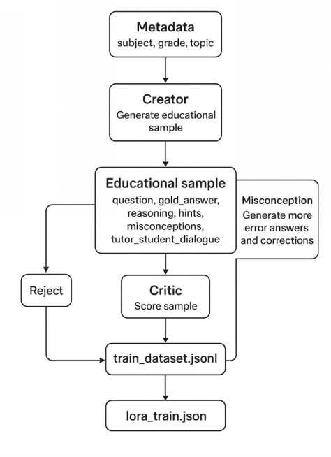
 **图 1：数据流程图**

### 2.3 后端配置

系统后端采用可扩展的多提供商大语言模型（LLM）接入架构，支持HuggingFace Router、Ollama、Qwen DashScope兼容模式以及所有OpenAI-Compatible接口。核心由LLMClient类实现，该类负责根据环境变量自动判断当前可用的模型服务提供商，并选择最高优先级的配置进行初始化，从而实现无缝切换与统一调用。

初始化过程中，系统首先检查 HuggingFace Inference/Router是否可用（取决于 HUGGINGFACE_API_TOKEN与模型配置），若可用则优先使用其OpenAI-compatible API；若本地部署了Ollama并配置了OLLAMA_HOST，则自动切换至本地模型服务；若检测到QWEN_API_KEY，则启用 Qwen DashScope 的兼容模式 API；若以上均未配置，则回落至默认的OpenAI-Compatible接口（使用OPENAI_API_KEY和 OPENAI_BASE_URL）。

LLMClient 提供统一的chat()方法，无论底层使用的是HuggingFace、Ollama、Qwen 还是 OpenAI，都能够以一致的消息格式发送对话，并返回标准化的文本输出。此外系统提供DRY_RUN调试模式，允许在无网络环境下运行整个数据生成流程，通过返回结构化的mock响应实现快速测试。这一机制确保了后端在多环境、多平台下均能稳定运行，既方便部署，也便于本地调试和大规模数据生成任务。

## 3. 技术实现细节

### 3.1 数据集生成

本项目的数据集通过多智能体自动化生成管线构建，旨在产出结构化、高质量、教学一致性的科学教育样本。首先，系统根据用户输入的元数据（如学科、年级、主题）生成基础任务描述，同时随机采样难度、认知维度、题目类型和学习场景等附加属性，以提升样本的多样性。随后，这些元数据被输入至Creator生成代理，该代理负责生成完整的教育样本，包括题目（question）、标准答案（gold_answer）、逐步推理（reasoning）、启发式提示（hints）、常见学生误区（misconceptions），以及教师–学生纠错对话（tutor_student_dialogue）。系统通过解析工具抽取模型响应中的首个JSON对象，以确保输出结构可靠。

为进一步丰富学生可能出现的错误类型，系统调用Misconception误区扩展代理，基于题目与答案生成更多具有代表性的错误答案与纠正方式。之后，Critic 审核代理对完整样本进行评分，考察其事实正确性、安全性、推理充分性以及是否与元数据难度匹配。若样本未通过审核，系统会在最多三次重试内重新生成，从而保证整体数据质量。

所有通过审核的样本被分别写入多类 JSONL 数据文件，包括：Biology_sample.jsonl、Chemistry_sample.jsonl、physics_batch.jsonl、physics_hs_newton.jsonl、physics_newton.jsonl、sample_batch.jsonl 和 sample.jsonl。这些文件涵盖不同学科、难度层次与主题的生成数据。随后，通过 Merge_data.py 脚本对所有样本文件进行汇总、清洗与去重，最终构建统一的大规模训练集 train_dataset.jsonl，作为模型训练的主要数据来源。

为了支持高效的参数化微调，本项目将合并后的训练集转换为适用于 LoRA（Low-Rank Adaptation）训练格式的数据文件 lora_train.json。在此过程中，所有样本被重新整理为 LoRA 所要求的标准输入–输出结构，使其能够直接用于下游的轻量级微调流程。最终得到的 LoRA 数据集结构统一、质量可控，能够稳定支撑模型的高质量教育类能力提升。
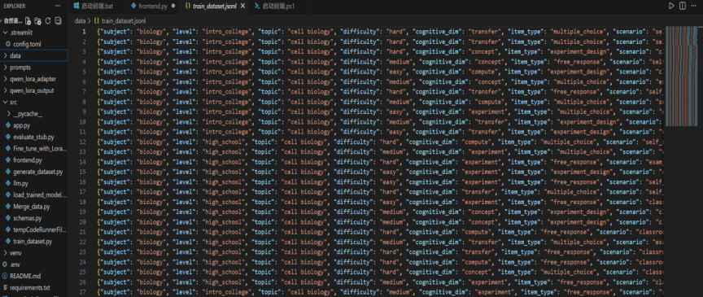

 **图 2 ：大规模训练集**
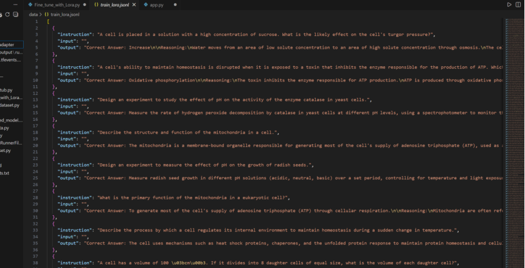
 **图 2 ：LoRA 数据集结构**

### 3.2 LoRA 微调

在本项目中，我们使用LoRA对Qwen2.5-1.5B-Instruct模型进行高效微调。LoRA的特点是：不用更新原始大模型的全部参数，而是在模型的重要层（如注意力的 q_proj、k_proj、v_proj、o_proj，以及前馈层的gate_proj、up_proj、down_proj）上加上低秩矩阵，只训练这些新增的小模块。这样大幅节省显存和训练时间。

模型以4bit量化方式加载，以减少显存占用，同时计算采用 bfloat16 保持数值稳定。数据集会先转换成ChatML对话格式，让模型学习“用户输入→助手回答”的结构。在分词时不做padding，并对标签进行掩码，保证损失只计算在助手输出部分，不影响输入内容。

训练采用8bit AdamW优化器、梯度累积（模拟更大的 batch size）、余弦退火学习率策略和warmup，同时不截断序列，保持数据完整。脚本中还加入了一个自定义回调，用于在每个训练 step 记录关键信息，如loss、学习率、梯度范数以及序列长度，用来监控训练是否稳定。

### 3.3 模型的界面与部署

#### 用户界面 (UI) 开发
- **框架**：Streamlit，1.一个用于创建交互式机器学习和数据科学Web应用的Python框架。
- **功能设计**：
  - **侧边栏控件**：
为了提供个性化的学习体验，我们设计了一个功能全面的侧边栏控件。用户首先可以从物理、化学、生物或综合科学中选择一个具体的学科领域，以聚焦学习内容。随后，他们可以根据自身水平设定难度等级，选项覆盖了初中、高中以及大学入门阶段，确保知识的匹配度。此外，系统还提供了多种学习模式，以满足不同的学习需求：用户可以选择“概念解释”来深入理解基础理论，使用“习题求解”来攻克具体难题，通过“文献查阅”来探索相关学术资料，或是在“自由问答”模式下进行开放式的探索与提问。
  - **高级设置**：
对于希望进一步定制交互体验的用户，我们提供了高级设置选项。在这里，用户可以精确调整模型生成回答的长度，通过设置max_tokens参数来控制回复的详尽程度。同时，用户还能调节模型的“创造性”，即temperature参数。较低的temperature 值会使回答更加严谨、确定，而较高的值则会激发模型生成更具创造性和多样性的文本，从而满足从严肃学术到发散性思维等不同场景的需求。
  - **聊天窗口**：
    应用程序的核心是一个清晰直观的聊天窗口，作为用户与AI助手互动的主要界面。该界面采用了经典的对话流布局，用户与助手的消息交替显示，形成自然的对话节奏。这种设计不仅符合用户的使用习惯，也让信息追溯变得简单明了，确保每一次互动都流畅且富有成效。
    
    为了在视觉上清晰区分用户与助手的角色，用户发送的消息采用了独特的视觉设计。所有用户消息都配有柔和的渐变背景，并始终右对齐显示。这种设计不仅在视觉上更加醒目，也模拟了现代即时通讯应用中“我”的发言样式，为用户带来了熟悉且亲切的交互体验。
    AI助手的回复则以一种优雅且易于阅读的方式呈现。每一条助手消息都被包裹在一个纯白色的卡片中，并配以一道纤细的彩色边框作为点缀，所有卡片均左对齐排列。这种卡片式设计，结合微妙的阴影效果，使得文本内容从背景中脱颖而出，极大地提升了可读性，并赋予了界面一种精致、专业的感觉。

  

#### 模型部署
我们的解决方案基于Qwen2.5基础模型构建，并采用LoRA（低秩适配）技术进行了微调。这项先进技术能高效地将模型专业化，使其专注于多学科科学辅导这一特定任务，从而提供更专业、更相关的回答。
- 部署： 通过streamlit run在任何GPU上进行简单的本地设置。
- 优化： 模型以半精度（float16）高效加载，应用LoRA适配器，并使用预热步骤以实现即时响应。
- 用户体验： 聊天回复实时流式传输，以实现流畅和互动的对话。
- 
  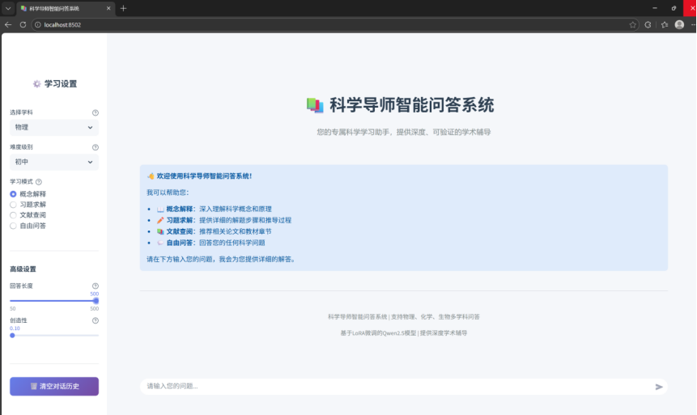
 **图 4–8：UI设计**

  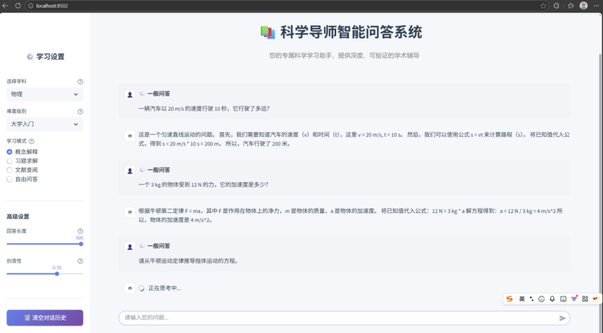
  **图 4–8：物理学回答**
  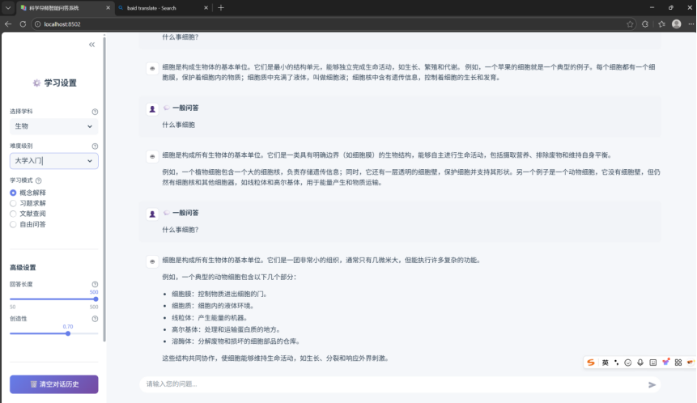、
  **图 4–8：生物学回答**
  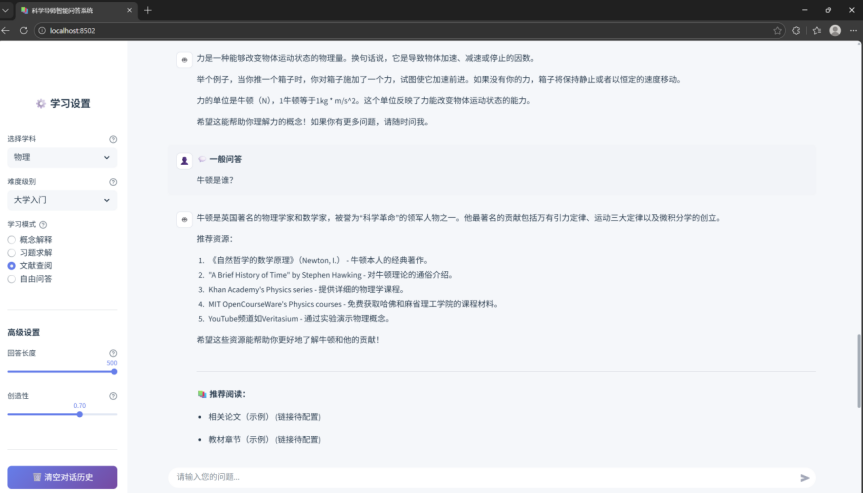
   **图 4–8：推荐学习资料**
  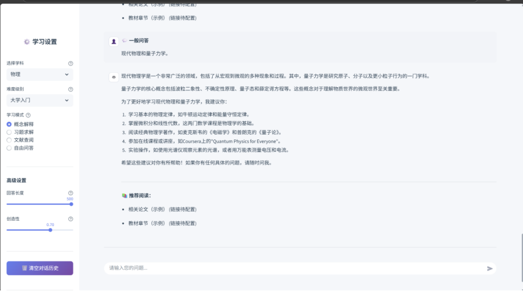
   **图 4–8：建议学生**

## 4. 实验结果与分析

### 4.1 LoRA 微调
 

- **训练损失曲线**：从训练损失曲线可以看出，微调过程顺利完成并成功收敛。损失值从最初的 1.2 以上开始，随着训练步骤稳步下降，最终接近于零。这样平滑且持续下降的趋势说明模型在训练过程中学习稳定，没有出现梯度爆炸、发散或明显的过拟合现象。最终损失非常低，表明微调后的模型已经很好地适应了目标任务，并能够在相似输入上表现出可靠的效果。
  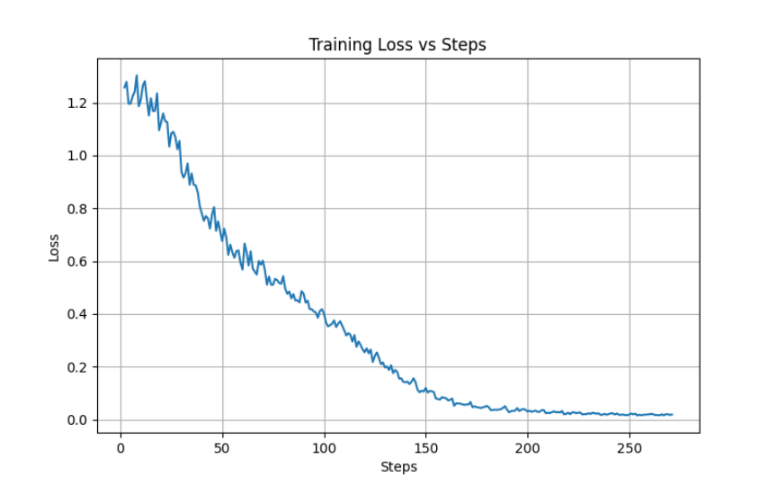
  **图 9–11：训练损失曲线**

- **梯度范数曲线**：梯度范数曲线表明整个训练过程是稳定且健康的。数值大致保持在 0.3–1.1 的合理范围内，没有出现梯度爆炸或梯度消失的迹象。前期下降趋势反映了正常的预热阶段，而后期的波动属于预期现象，因为有效批大小较小，且 LoRA 的更新会带来一定的自然变化。
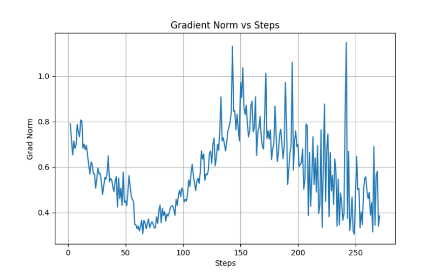
**图 9–11：梯度范数曲线**

- **学习率曲线**：这条学习率曲线整体表现非常合理，符合常见的微调策略。曲线一开始以缓慢的方式进行 warm-up，让模型在初期先稳定下来，然后在大约 8e-5 达到最大学习率。之后学习率逐步下降，使后期的更新更加平稳、精细。这样的“先升后降”学习率调度非常适合 LoRA 微调，有助于维持训练的稳定性，并与训练损失曲线中呈现出的平滑下降趋势相一致。
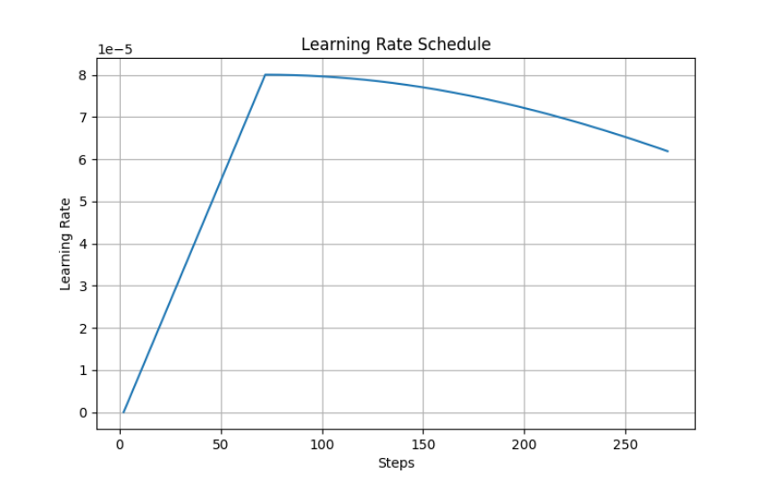
**图 9–11：学习率曲线**

### 4.2 性能观察

1. **硬件依赖**：  
模型的推理过程完全依赖于GPU，这是保证其性能的基础。然而，在普通性能的GPU上处理长文本输入时，用户可能会感受到明显的延迟。例如，当输入一个包含约200至400个tokens的复杂问题时，生成完整的回答可能需要数秒钟的时间。此外，响应延迟也与生成文本的长度直接相关，设置较高的max_tokens值会显著增加计算负担，从而导致更长的等待时间。因此，在硬件配置和生成长度之间需要做出权衡，以平衡响应速度与回答的完整性。

2. **学科表现不均衡**：  
在我们的项目中，模型在物理、化学和生物问题上的表现存在明显差异。一个主要原因是微调数据的不平衡：我们拥有大量与物理相关的示例，但化学和生物的数据访问有限，导致这些学科的训练样本较少。因此，模型在大学水平的物理问题上表现明显优于化学或生物。从生物学的答案上看得出来明显的存在缺点。
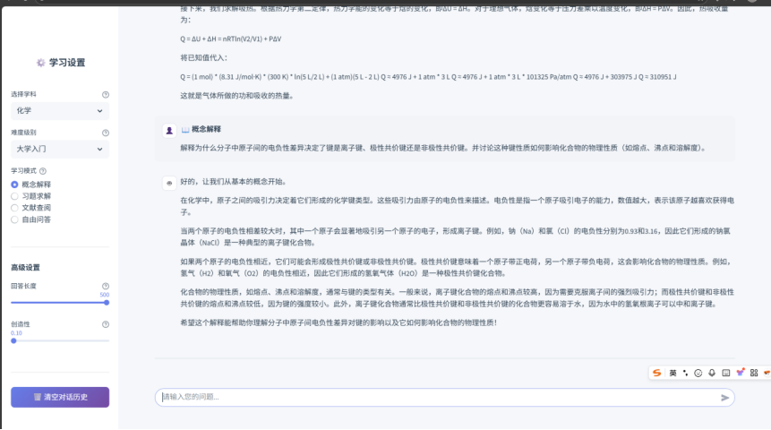 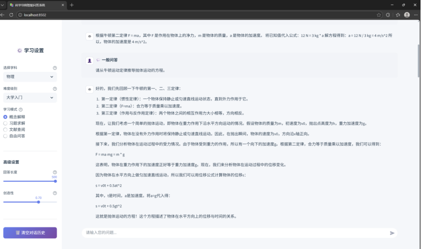 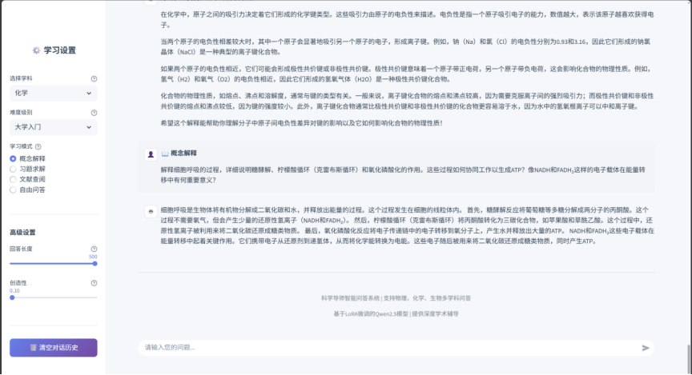

3. **科学知识本质性挑战**：  
科学知识是本质的——科学依赖精确且数学严格的数据，即使是小的错误也可能导致错误的结论。像我们这样的大型语言模型（LLM）并不能真正“理解”科学概念；它们是基于学习到的语言模式生成回答，而不是基于物理定律或实验推理。尤其在物理领域，LLM可能生成听起来合理但违反基本原理的答案，错误应用公式，或者在提示不够明确时做出错误假设（例如忽略空气阻力或假设真空条件）。此外，LLM缺乏内部推理引擎或符号计算工具来进行精确计算，这意味着涉及正式计算的复杂问题可能会产生错误。
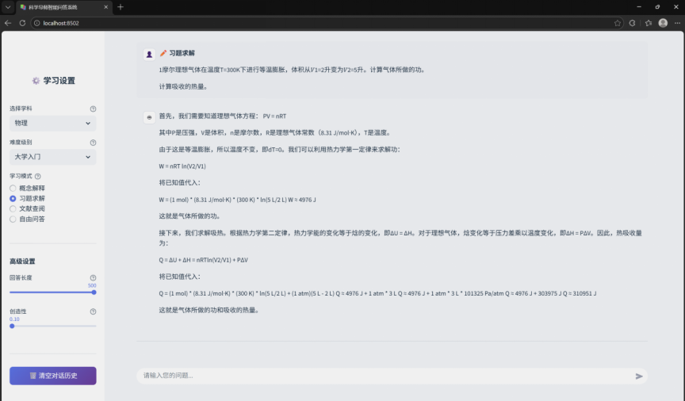

**图 12–13：物理学计算错误示例**

## 5. 遇到的问题与解决方案

### 5.1 多智能体协作中的“答非所问”与指令遵循问题

在数据生成初期，我们面临的最大挑战是智能体的指令遵循能力不足,尽管我们在Prompt中明确要求Fixer Tutor采用“苏格拉底式引导”，但在多轮对话的后半段，模型往往会发生“指令漂移”，失去耐心直接抛出正确答案，或者生成的 Misconception（误解）过于牵强，不符合人类学生的认知习惯;我们分析发现，由于 Qwen基座模型的上下文窗口限制，当对话历史过长时，系统提示词的权重会被稀释,此外，生成错误的推理过程本身比生成正确答案更违背LLM预训练时的对齐逻辑。

为了解决这个问题，我们引入了思维链强化与结构化约束策略，我们修改了Prompt，强制Creator和Fixer在输出最终对话前，必须先在一个隐藏的JSON字段中输出 thinking_process，明确当前的教学目标和学生的错误类型。这种先想后说的机制显著提升了对话的逻辑连贯性，与此同时，我们调高了Critic智能体的审核阈值，任何缺乏启发性或直接给出答案的样本会被直接驳回重造，确保只有高质量的引导式对话才能进入训练集。

### 5.2 API 调用限流与网络不稳定性

为了构建覆盖多学科的大规模数据集，我们需要进行数万次的LLM API调用，这在实际操作中遇到了严重的网络与配额瓶颈，在通宵运行生成脚本时，经常因为网络波动或触发提供商的速率限制导致脚本中断，产生了大量损坏的JSONL文件，严重拖慢了进度。

为了解决这个问题，我们在后端架构中设计了鲁棒的容错与熔断机制，我们封装了LLMClient类，建立了一个包含HuggingFace、Ollama和 DashScope的模型池，当主线路报错429或500时，系统不会崩溃，而是自动切换至备用API继续任务，同时，我们采取了指数退避重试的措施，实现了自动化的重试逻辑，当请求失败时，系统会按指数级增加等待时间再次尝试，配合断点续传功能，保证了数据生成流水线能够无人值守地稳定运行。

### 5.3 算力约束下的显存溢出
作为学生团队，我们可用的计算资源主要局限于单张消费级GPU，这对于训练大语言模型来说显得捉襟见肘，在尝试对Qwen2.5-1.5B进行全量参数微调时，显存瞬间耗尽。即便切换到LoRA模式，若Batch Size设置稍大，依然频发CUDA Out of Memory错误。

为了解决这个问题，我们采取了极致的显存优化组合拳，在性能与资源之间找到了平衡点，我们利用bitsandbytes库将基座模型以4-bit精度加载，将模型权重的显存占用压缩至极致，同时计算时使用bfloat16保证数值稳定性，除此之外，为了在小显存上模拟大Batch Size的训练效果，我们将实际Batch Size设得很小，通过多次前向传播累积梯度后再进行一次反向传播更新。这不仅避免了显存溢出，还保证了梯度的准确性，如实验图表所示，Loss 曲线下降非常平滑。

### 5.4 学科数据分布不均衡

在实验结果分析中，我们观察到模型在物理题目上的表现优于生物和化学，这说明了合成数据存在内在偏差的现象，具体表现为Creator智能体在生成物理题时，依托公式和定律很容易生成逻辑严密的题目；而在生成生物或者化学题时，由于涉及大量非结构化的描述性知识，容易产生事实性错误，导致通过Critic审核入库的生化类样本数量远少于物理类。

为了解决这个问题，我们采取了加权采样的策略。在构建train_dataset.jsonl时，我们人为提高了生物和化学样本的采样权重，防止模型在训练过程中过度拟合物理领域的模式。同时，这也为我们未来的工作指明了方向：需要引入外部知识库来辅助生成非计算类的学科数据。

## 6. 结论

本项目立足于自然语言处理与智慧教育的交叉前沿，成功构建并验证了一个垂直领域的“科学家教系统”，通过本次课程大作业的完整实践，我们得出以下核心结论：
第一，验证了“合成数据+小模型微调”范式在教育垂直领域的有效性。我们的实验强有力地证明，在特定垂类任务中，数据的质量远比模型的参数量更关键。尽管 Qwen2.5-1.5B只是一个轻量级模型，但通过喂养我们精心构建的、包含思维链（CoT）和纠错逻辑的高质量合成数据，它在教学引导能力上表现出了惊人的潜力。这为教育大模型的低成本、端侧部署提供了切实可行的路径。

第二，实现了从知识检索到能力习得的跨越。传统的问答系统往往只是机械地检索答案，而我们的微调模型通过学习Fixer Tutor的对话数据，学会了在面对学生错误时，不是直接给出答案，而是通过追问引导学生自我纠错。这种行为对齐的成功，证明了LLM可以通过微调改变其交互模式，使其更符合教育心理学的要求。
第三，打通了LLM应用开发的全栈工程闭环。不同于以往仅停留在API调用层面的实验，本次项目要求我们亲手走通了从数据合成、清洗、格式转换，到模型微调、参数监控，再到前端Streamlit交互式部署的每一个环节。这一过程让我们深刻认识到，一个成功的AI产品，算法模型只是冰山一角，背后的数据工程和系统架构同样决定了最终的成败。

## 7. 未来工作
虽然目前的系统已经具备了雏形，展现出了作为智能助教的潜力，但距离一个真正成熟、可信赖的教育产品还有很长的路要走。基于当前的局限性与实验反思，我们规划了以下四个维度的改进方向：
### 7.1 引入 RAG 以解决幻觉问题
目前的模型所有知识都内化在参数中，这导致了两个问题，一是知识更新困难，二是对于具体的科学常数或冷门知识容易产生幻觉。未来我们计划引入向量数据库，权威的教科书、学术论文及标准题库。当用户提问时，系统先检索相关的知识片段作为上下文输入模型。这不仅能大幅提高回答的事实准确性，还能真正实现UI中预留的文献查阅功能，让模型的每一个回答都由据可查。

### 7.2 建立自动化评分机制
目前的系统缺乏对模型输出质量的实时监控与反馈，由于人工评估耗时耗力，导致迭代周期较长。未来我们计划引入一个基于GPT-4的自动评分智能体（Auto-Grader），构建一套自动化评估流水线。它可以对微调后模型的每一次教学对话进行多维度打分（准确性、引导性、安全性）。这些高分样本可以自动回流到训练集中，低分样本则触发警报。

### 7.3 扩展多模态交互能力
科学教育离不开图表、公式和实验现象的观察。目前的系统仅支持纯文本交互，这在处理物理受力分析或生物结构识别时存在天然短板。未来我们将尝试引入视觉编码器与语言模型对齐，让模型能够看懂用户上传的几何图形或细胞照片，并基于图像内容进行辅导，实现真正的图文交互式教学。

### 7.4 增强安全性与价值观对齐
虽然我们在Creator阶段加入了安全性检查，但对于恶意诱导（如询问危险化学实验的配方），当前小模型的防御能力可能不足。未来我们需要构建专门的Red Teaming数据集，模拟各种攻击性提问。通过DPO（直接偏好优化）或 RLHF（基于人类反馈的强化学习）算法，进一步加固模型的安全围栏，确保其在教育场景下的绝对安全与合规。

附录：项目文件结构与脚本说明。

